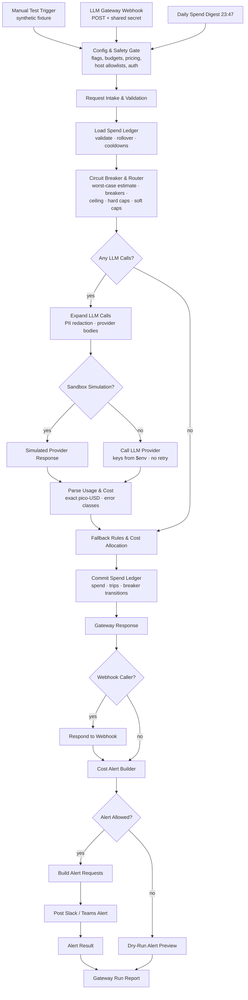

# n8n-llm-token-spend-circuit-breaker-cost-allocator

**An AI gateway wrapper and circuit breaker for OpenAI and Anthropic, built in n8n.** It tracks token spend per workflow, client, campaign and cost center. It enforces hard and soft daily caps, allocates costs across internal cost centers, and degrades gracefully to fast, deterministic fallback rules (regex classification, rule-based scoring, template replies, extractive summaries) when a budget is exhausted or a provider fails.

```
request ──► validate ──► pre-flight worst-case estimate ──► breaker / caps ──► provider call ──► usage → exact cost ──► ledger
                                                              │                    │
                                                              └── fallback rules ◄─┘  (over budget · 429 · 529 · timeout · quota · unpriced)
```

Cost overruns in LLM automations rarely come from one big request. They come from a loop, a retry storm, a prompt that grew, or a campaign nobody capped. This workflow puts one gate in front of every model call. Each request is priced *before* it is sent, at worst case, against the remaining budget of every scope it belongs to. Then it is called, downgraded to a cheaper model, or answered by rules in a few milliseconds. Every completed call is costed from the provider's own usage block, in exact integer arithmetic, and attributed down to the cost center.

> **Safe by default.** Out of the box the workflow runs in `SANDBOX_MODE=true` against a synthetic fixture. Provider responses are simulated: **zero** network calls, no alerts, and n8n static data is never touched. Live LLM calls and live alerts each need their own explicit opt-in.

---

## Contents

- [What it does](#what-it-does)
- [Architecture](#architecture)
- [Prerequisites](#prerequisites)
- [Quick start (sandbox, 2 minutes)](#quick-start-sandbox-2-minutes)
- [Going live in stages](#going-live-in-stages)
- [Calling the gateway](#calling-the-gateway)
- [Environment variables](#environment-variables)
- [Token cost attribution logic](#token-cost-attribution-logic)
- [Circuit breaker logic](#circuit-breaker-logic)
- [Fallback rules](#fallback-rules)
- [Alerts](#alerts)
- [Safety model](#safety-model)
- [Compliance checklist](#compliance-checklist)
- [Offline simulator](#offline-simulator)
- [Troubleshooting](#troubleshooting)
- [Repository layout](#repository-layout)
- [Disclaimer](#️-disclaimer--liability-limitation)

---

## What it does

| Capability | Detail |
|---|---|
| Per-scope spend tracking | Daily ledger by **global**, **client**, **workflow**, **campaign**, **cost center**, provider and model, in integer nano-USD. |
| Hard caps | A request whose worst-case cost would push any scope past its cap (minus a safety margin) never reaches the provider. In `trip_scope` mode it **trips** that scope for the rest of the budget day. |
| Soft caps | Past `DAILY_SOFT_CAP_PCT` (or a scope's `softPct`), requests are **downgraded** to a cheaper model of the same provider and their output is clamped (or routed to rules, or allowed, by policy). |
| Per-request ceiling | `PER_REQUEST_MAX_USD` stops one giant prompt from eating the day. It downgrades the request if that fits, otherwise falls back. |
| Provider breakers | Consecutive timeouts / 429 / 529 / 5xx open that provider's breaker for a cooldown. Exhausted credit or quota opens it until the next budget day. After the cooldown, one probe request decides between closing and re-opening. |
| Exact cost from usage | OpenAI `prompt_tokens` / `cached_tokens` / `completion_tokens` (reasoning included). Anthropic `input_tokens` / `cache_creation_input_tokens` / `cache_read_input_tokens` / `output_tokens`. Long-context tiers are applied where the provider publishes them. |
| Cost-center allocation | Direct attribution, `COST_CENTER_MAP_JSON` defaults, and **shared** spend split by integer weights with an exact largest-remainder split. |
| Graceful fallback | Deterministic answers for `classify`, `score`, `reply`, `extract` and `summarize`, so the calling automation keeps working when the budget doesn't. |
| Fail closed | Config errors, an untrusted ledger, unpriced models, oversized inputs, missing attribution and invalid requests never reach a provider. |
| Privacy | Emails, phone numbers and card-like numbers are redacted before sending (`REDACT_PII_BEFORE_LLM`). Prompts never appear in the ledger, alerts or the run report. |
| Alerts | Slack Block Kit and Microsoft Teams Adaptive Card. Each event is sent once per budget day, plus an optional daily digest. |

---

## Architecture



26 nodes: 3 triggers, 1 sticky note, 15 Code nodes, 4 IF nodes, 2 HTTP Request nodes and 1 Respond to Webhook. The LLM HTTP node and the alert HTTP node are the only nodes that touch the network, and both read their secrets from `$env` only.

---

## Prerequisites

- **n8n** 1.x or later (tested on n8n 2.47.7, self-hosted). Core nodes only; no community nodes.
- `N8N_BLOCK_ENV_ACCESS_IN_NODE=false`, so `{{ $env.X }}` resolves. If env access is blocked, the workflow detects it and stays in sandbox mode.
- **API keys** (live only): an OpenAI and/or Anthropic key. Use **dedicated keys or projects with their own provider-side spending limits** for this gateway, so you have two independent limits (provider console + this workflow).
- **Webhook URLs** (alerts only): a Slack incoming webhook and/or a Teams Workflows webhook ("Post to a channel when a webhook request is received") for a *private* channel. Office 365 connectors are retired; the payload targets the Workflows trigger.
- **Persistence:** the spend ledger lives in the workflow's static data, which n8n saves for **production executions** (active workflow, triggered by the webhook or schedule). Editor test runs may not persist it. For hard guarantees under heavy concurrency, see [Concurrency](#concurrency-and-the-safety-margin).

---

## Quick start (sandbox, 2 minutes)

```bash
# 1. Run the offline simulator. Zero dependencies, zero network.
node scripts/simulate-sandbox-run.js
#    → 132 checks; gateway response, alert previews and report in sim-output/

# 2. Import into n8n
#    Workflows → Import from File → workflow.json  (arrives inactive)

# 3. Click "Test workflow" on the Manual Test Trigger.
#    21 synthetic requests run through the breaker with simulated provider
#    responses. Ends at "Gateway Run Report" with alert status BLOCKED.
```

Open **Gateway Response** to see every routing decision, cost and allocation, and **Dry-Run Alert Preview** to see the alert that *would* be posted. The fixture tells the story of one budget day, starting from $0.77 of a $1.00 example cap:

| Requests | Scenario |
|---|---|
| req-001, req-002 | Low spend: LLM OK; Anthropic prompt-cache reads billed at the cache-hit rate |
| req-003 | Client soft cap → Sonnet downgraded to Haiku, output clamped |
| req-004 | Client hard cap → client scope tripped, template reply |
| req-005, req-006 | OpenAI 429 and a timeout → regex fallbacks (the timeout is charged at its estimate) |
| req-007 | Shared cost center → exact 60/40 split; OpenAI cached tokens |
| req-008 | Success without a usage block → charged at the estimate |
| req-009 | Email and phone redacted before sending |
| req-010 to req-013 | Unpriced model, oversized input, missing attribution, unsupported task: fail closed |
| req-014, req-015 | Global soft cap → Astra downgraded to Luna; a critical request bypasses the soft cap |
| req-016 | `insufficient_quota` → OpenAI breaker open until the next budget day |
| req-017 to req-019 | Three Anthropic failures (529, 429, timeout) → Anthropic breaker open for 15 minutes |
| req-020, req-021 | Global hard cap trips; every later request uses fallback rules |

> In sandbox only, the fixture's example budgets (`sandboxBudgets`) stand in for budget variables you haven't set. Set `DAILY_HARD_CAP_USD` / `BUDGETS_JSON` to test your own.

---

## Going live in stages

Each stage turns on **one** capability.

| Stage | Set | Result |
|---|---|---|
| 0. Sandbox | *(nothing)* | Simulated providers, zero network calls. |
| 1. Live dry run | `SANDBOX_MODE=false`, `WEBHOOK_SHARED_SECRET`, budgets, `BUDGETS_JSON` | Real requests via the webhook; every decision is computed, nothing is sent (`DRY_RUN`). Answers come from fallback rules with `would_route: "llm"`. |
| 2. Live calls | `DRY_RUN=false`, `LLM_CALLS_ENABLED=true`, `OPENAI_API_KEY` / `ANTHROPIC_API_KEY` | Calls go out under the breaker; the ledger persists. Start with a **low** `DAILY_HARD_CAP_USD`. |
| 3. Alerts | `ALERTS_ENABLED=true`, `ALERT_CHANNELS`, the webhook URL(s) for a **private** channel | Cost alerts on events, plus the daily digest. |
| 4. Activate | Toggle the workflow active | Production webhook URL and the 23:47 digest. |

### Sample `.env` for stage 2

```bash
SANDBOX_MODE=false
DRY_RUN=false
LLM_CALLS_ENABLED=true
CIRCUIT_BREAKER_ACTIVE_BY_DEFAULT=true
OPENAI_API_KEY=          # from your secret manager
ANTHROPIC_API_KEY=       # from your secret manager
WEBHOOK_SHARED_SECRET=   # 16+ random characters
DAILY_HARD_CAP_USD=2.00
DAILY_SOFT_CAP_PCT=80
PER_REQUEST_MAX_USD=0.10
BUDGET_UTC_OFFSET_MINUTES=0
BUDGETS_JSON={"clients":{"client_alpha":{"hardUsd":"0.75"}},"campaigns":{"camp_q4_launch":{"hardUsd":"0.50","softPct":90}}}
```

---

## Calling the gateway

```bash
curl -X POST "https://<your-n8n-host>/webhook/llm-gateway" \
  -H "Content-Type: application/json" \
  -H "x-gateway-secret: $WEBHOOK_SHARED_SECRET" \
  -d '{
    "requests": [{
      "request_id": "ticket-48213",
      "task": "classify",
      "provider": "openai",
      "model": "gpt-5-mini",
      "input": "The export page shows an error since this morning.",
      "labels": ["billing", "technical_support", "general"],
      "max_output_tokens": 16,
      "client_key": "client_alpha",
      "workflow_id": "wf_ticket_triage",
      "campaign_id": "camp_q4_launch",
      "cost_center": "cc-support",
      "priority": "normal"
    }]
  }'
```

| Field | Required | Notes |
|---|---|---|
| `task` | yes | `classify`, `score`, `reply`, `extract` or `summarize`. Each has a deterministic fallback. |
| `model` | yes | Must be priced (built-in table or `MODEL_PRICING_JSON`). Dated snapshots such as `gpt-5.4-2026-03-05` resolve to their base price. |
| `provider` | inferred | `openai` or `anthropic`; must match the model's provider. |
| `input` | yes | Over `MAX_INPUT_CHARS` → `INPUT_TOO_LARGE` fallback (never sent). |
| `client_key`, `workflow_id` | yes* | *Required while `REQUIRE_ATTRIBUTION=true`. `[A-Za-z0-9_.:-]`, up to 64 characters. |
| `campaign_id`, `cost_center` | no | `cost_center: "shared"` triggers weighted allocation. |
| `system`, `labels`, `template_vars`, `max_output_tokens`, `priority` | no | `priority: "critical"` bypasses soft caps only. |

**Response** (per request): `status` (`LLM_OK`, `LLM_DOWNGRADED`, `FALLBACK`, `REJECTED`), `output`, `fallback.reason`, `model_used`, `downgraded_from`, `usage`, `cost_usd`, `estimate_usd`, `charged` (`actual` / `estimate` / `none`), `attribution`, `allocation_usd` and `flags`, plus day `spend`, `breakers` and `events`. Prompts are never echoed back.

---

## Environment variables

All values are read only from `$env`. The complete template, with safe defaults and examples, is in [.env.example](.env.example).

### Safety switches

| Variable | Default | Turns on/off when | Effect |
|---|---|---|---|
| `SANDBOX_MODE` | `true` | *off* only on `false/0/no/off` | Simulated providers, no network, no static data |
| `DRY_RUN` | `true` | *off* only on `false/0/no/off` | Decisions only: no LLM calls, no alerts, no persistence |
| `CIRCUIT_BREAKER_ACTIVE_BY_DEFAULT` | `true` | *off* only on `false/0/no/off` | `false` = monitor-only: caps and breakers are tracked and alerted but don't block |
| `REQUIRE_ATTRIBUTION` | `true` | *off* only on `false/0/no/off` | Rejects requests without `client_key` / `workflow_id` |
| `REDACT_PII_BEFORE_LLM` | `true` | *off* only on `false/0/no/off` | Pattern-based redaction before sending |
| `LLM_CALLS_ENABLED` | `false` | `true/1/yes/on` | Allows real provider calls |
| `ALERTS_ENABLED` | `false` | `true/1/yes/on` | Allows Slack / Teams posts |
| `LLM_KILL_SWITCH` | `false` | `true/1/yes/on` | Every request uses fallback rules |
| `LEDGER_RESET` | `false` | `true/1/yes/on` | Replaces an **invalid** ledger with a fresh one |
| `FORCE_ALERT` | `false` | `true/1/yes/on` | Re-sends events already alerted today |

A typo (for example `SANDBOX_MODE=flase`) keeps the safe value.

### Budgets and policy

| Variable | Default | Notes |
|---|---|---|
| `DAILY_HARD_CAP_USD` | `5.00` | Global cap. Decimal USD with up to 9 places; no negative or scientific values. |
| `DAILY_SOFT_CAP_PCT` | `80` | Default soft threshold for every scope. |
| `PER_REQUEST_MAX_USD` | `0.25` | Worst-case ceiling for one request. |
| `BUDGET_SAFETY_MARGIN_PCT` | `5` | Hard caps are enforced at `cap × (100 − margin)%`. |
| `SOFT_CAP_ACTION` | `downgrade` | `downgrade`, `fallback` or `allow`. |
| `HARD_CAP_TRIP_MODE` | `trip_scope` | `trip_scope` trips the scope for the day; `per_request` only blocks the overrunning request. |
| `CRITICAL_BYPASSES_SOFT_CAP` | `true` | Critical requests skip soft-cap downgrades. Hard caps always apply. |
| `BUDGETS_JSON` | *(none)* | Scope caps: `{"clients":{…},"workflows":{…},"campaigns":{…},"costCenters":{…}}`, each `{"hardUsd":"…","softPct":…}`. |
| `BUDGET_UTC_OFFSET_MINUTES` | `0` | Budget-day boundary (fixed offset; DST is not applied). |
| `COST_CURRENCY` | `USD` | Only USD is accepted (providers bill in USD). |

### Pricing, models and estimation

| Variable | Default | Notes |
|---|---|---|
| `MODEL_PRICING_JSON` | *(none)* | `{"model":{"provider":"openai","input":"…","cachedInput":"…","output":"…","long":{"aboveInputTokens":272000,…}}}`. Anthropic models also take `cacheWrite`. |
| `MODEL_PRICING_MODE` | `merge` | `merge` with the built-in table, or `replace` it. |
| `PRICING_AS_OF` / `PRICING_MAX_AGE_DAYS` | `2026-11-17` / `60` | A stale table raises a warning in every alert. |
| `UNPRICED_MODEL_POLICY` | `block` | `block` → fallback; `max_rate` → reserve at the provider's highest known rate. |
| `ALLOWED_MODELS` | *(all priced)* | Comma-separated allowlist. |
| `DOWNGRADE_MAP_JSON` | built-in | `{"from":"to"}`; same provider and cheaper only (validated). |
| `CHARS_PER_TOKEN_ESTIMATE` | `3` | Lower = more conservative. |
| `PROMPT_OVERHEAD_TOKENS` | `16` | Added to every estimate. |
| `DEFAULT_MAX_OUTPUT_TOKENS` / `MAX_OUTPUT_TOKENS_CAP` / `SOFT_CAP_MAX_OUTPUT_TOKENS` | `512` / `2048` / `256` | |
| `MAX_INPUT_CHARS` / `MAX_REQUESTS_PER_RUN` | `20000` / `25` | A batch larger than the limit is refused as a whole. |

### Providers, breaker, allocation, alerts

| Variable | Default | Notes |
|---|---|---|
| `OPENAI_API_KEY` / `ANTHROPIC_API_KEY` | — | Secrets. Read only in the HTTP node headers. |
| `OPENAI_API_BASE_URL` / `ANTHROPIC_API_BASE_URL` | official APIs | `scheme://host[:port]` only; the host must be in `LLM_ALLOWED_HOSTS`. |
| `LLM_ALLOWED_HOSTS` | `api.openai.com,api.anthropic.com` | |
| `LLM_TIMEOUT_MS` / `MAX_RESPONSE_CHARS` | `30000` / `8000` | |
| `BREAKER_FAILURE_THRESHOLD` / `BREAKER_COOLDOWN_MINUTES` | `3` / `15` | |
| `SHARED_COST_CENTER_KEY` / `SHARED_COST_ALLOCATION_JSON` | `shared` / `{"cc-marketing":60,"cc-sales":40}` | Positive integer weights. |
| `COST_CENTER_MAP_JSON` / `DEFAULT_COST_CENTER` | `{}` / `cc-unallocated` | |
| `FALLBACK_*_JSON` | built-in | Classification rules, score rules, reply templates (regexes validated and ReDoS-guarded). |
| `ALERT_CHANNELS` | `slack` | `slack`, `teams` or `slack,teams`. |
| `SLACK_WEBHOOK_URL` / `TEAMS_WEBHOOK_URL` | — | Secrets; https only; host allowlisted. |
| `NOTIFY_ALLOWED_HOST_SUFFIXES` | Slack + Teams hosts | |
| `ALERT_DIGEST_ON_SCHEDULE` / `ALERT_TITLE` / `ALERT_MAX_ROWS` | `true` / `LLM Spend Circuit Breaker` / `5` | |
| `WEBHOOK_SHARED_SECRET` | — | 16+ characters; required for live webhook calls. |
| `NOW_OVERRIDE` | — | Pins "now" for reproducible tests. |

---

## Token cost attribution logic

### 1. Integer money

| Quantity | Unit | Example |
|---|---|---|
| Price | micro-USD per million tokens | $0.075 / MTok → `75000` |
| Call cost | pico-USD (`tokens × price`, exact) | 512 cached tokens × 75000 = 38,400,000 pico |
| Ledger | nano-USD (`ceil(pico / 1000)`) | rounds *up*: never under-counts |

Prices with more than 6 decimals, budgets in scientific notation, negative values and fractional ledger values are rejected. Every addition is checked with `Number.isSafeInteger`, and the cost-center allocation is verified to sum exactly to the run's spend before the ledger is touched.

### 2. Pricing table

The built-in table holds the providers' published standard rates as of **2026-11-17** (USD per million tokens):

| Provider | Models (input / cached input / output; Anthropic also has a 5-minute cache write) |
|---|---|
| OpenAI | `gpt-6-astra` 10 / 1 / 50 · `gpt-6.1-sol` 2 / 0.10 / 10 · `gpt-6.1-terra` 1 / 0.05 / 5 · `gpt-6-luna` 0.10 / 0.01 / 0.50 · `gpt-5.5` 5 / 0.50 / 30 · `gpt-5.4` 2.50 / 0.25 / 15 · `gpt-5.4-mini` 0.75 / 0.075 / 4.50 · `gpt-5.4-nano` 0.20 / 0.02 / 1.25 · `gpt-5-mini` 0.25 / 0.025 / 2 · `gpt-5-nano` 0.05 / 0.005 / 0.40 · `gpt-4.1-mini` · `gpt-4o-mini` |
| Anthropic | `claude-fable-5-2` 8 / 0.20 / 40 (write 10) · `claude-opus-5-5` 4 / 0.20 / 20 (write 5) · `claude-sonnet-5-5` 2 / 0.10 / 10 (write 2.50) · `claude-haiku-5-5` 0.10 / 0.01 / 0.50 (write 0.125) · `claude-sonnet-4-5` · `claude-haiku-4-5` |

Long-context tiers: the OpenAI flagship models listed with long-context rates (above 272K input tokens), and Claude Haiku 5.5 above a 100K-token prompt. For Haiku, cache reads and writes count toward the prompt length.

The table does **not** model Batch API discounts, fast or priority modes, data-residency multipliers or taxes. Providers change prices, so **verify** the table against the official pricing pages and override it with `MODEL_PRICING_JSON` and `PRICING_AS_OF`. A table older than `PRICING_MAX_AGE_DAYS` puts a warning on every alert.

### 3. Pre-flight estimate (worst case)

```
estInputTokens = ceil((system + input chars) / CHARS_PER_TOKEN_ESTIMATE) + PROMPT_OVERHEAD_TOKENS
estimate       = estInputTokens × inputRate + max_output_tokens × outputRate
```

Every request is reserved at its *full* `max_output_tokens`, at the uncached input rate. Reservations accumulate in batch order, so a batch can't collectively overshoot a cap.

### 4. Actual cost from the provider's usage block

| Provider | Billed as |
|---|---|
| OpenAI (Chat Completions or Responses) | `(prompt − cached) × input + cached × cachedInput + completion × output`. Reasoning tokens are part of `completion_tokens` and billed as output. |
| Anthropic Messages | `input_tokens × input + cache_creation × cacheWrite + cache_read × cachedInput + output_tokens × output` |

Usage is validated: integers, non-negative, `cached ≤ prompt`, `reasoning ≤ completion`, a `total_tokens` consistency flag, and a 5M-token sanity bound. If usage is **missing or invalid**, the call is charged at its pre-flight estimate (`charged: "estimate"`), never at zero. **Timeouts are also charged at the estimate**, because the provider may have processed and billed the request.

### 5. Attribution and allocation

Each charged request adds its cost to `global`, `clients[client_key]`, `workflows[workflow_id]`, `campaigns[campaign_id or "none"]`, `providers` and `models`. The cost center comes from `cost_center`, then `COST_CENTER_MAP_JSON[client_key]`, then `DEFAULT_COST_CENTER`.

When `cost_center` is `shared`, the cost is split by the integer weights in `SHARED_COST_ALLOCATION_JSON` using the largest-remainder method. With 60/40 weights, 1,000,000,001 nano-USD splits into 600,000,001 + 400,000,000. The parts always sum exactly to the total, and the split is deterministic for ties. Cost-center caps check each share against its own cost center.

---

## Circuit breaker logic

Decisions run per request, in this order. The first match wins.

| # | Check | Outcome |
|---|---|---|
| 1 | Invalid request (task, model, input, attribution, provider mismatch) | `REJECTED` |
| 2 | Config error · ledger untrusted · kill switch · input too large · unpriced or disallowed model | `FALLBACK` (applies in monitor-only mode too) |
| 3 | Provider breaker `OPEN` (or `HALF_OPEN` with its probe already used) | `FALLBACK BREAKER_OPEN` / `BREAKER_HALF_OPEN` |
| 4 | Estimate > `PER_REQUEST_MAX_USD` | Downgrade if that fits, else `FALLBACK REQUEST_COST_CEILING` |
| 5 | Scope tripped today | `FALLBACK HARD_CAP_TRIPPED` |
| 6 | `spent + reserved + estimate > cap × (100 − margin)%` for any scope | `FALLBACK HARD_CAP_<SCOPE>`; trips the scope in `trip_scope` mode |
| 7 | `spent + reserved + estimate > cap × softPct%` | `SOFT_CAP_ACTION`: downgrade + clamp output / fallback / allow (critical bypasses) |
| 8 | Dry run · calls disabled · provider key missing | `FALLBACK DRY_RUN` / `LLM_CALLS_DISABLED` / `PROVIDER_KEY_MISSING` (`would_route: "llm"`) |
| 9 | Otherwise | Call the provider |

**Provider errors → fallback reason** (and whether the error counts toward the breaker):

| Response | Reason | Breaker |
|---|---|---|
| Transport timeout | `LLM_TIMEOUT` (charged at estimate) | counts |
| DNS / connection error | `NETWORK_ERROR` | counts |
| 429 | `RATE_LIMITED` (`retryAfterSec` from the header) | counts |
| 429 `insufficient_quota`, 402, `billing_error`, "credit balance is too low" | `PROVIDER_BUDGET_EXCEEDED` | opens **until the next budget day** |
| 529 / 503 / `overloaded_error` | `PROVIDER_OVERLOADED` | counts |
| 401 / 403 | `PROVIDER_AUTH_ERROR` | counts |
| other 5xx | `PROVIDER_SERVER_ERROR` | counts |
| other 4xx | `PROVIDER_REQUEST_ERROR` | doesn't count |

Breaker states: `CLOSED` → (`BREAKER_FAILURE_THRESHOLD` consecutive failures) → `OPEN` for `BREAKER_COOLDOWN_MINUTES` → `HALF_OPEN`, which allows one probe. A successful probe closes the breaker; a failed one re-opens it immediately. A success resets the failure count. An exhausted-quota breaker is not closed by a later success in the same batch.

**Ledger integrity.** The ledger is validated on every run:

- Integer, non-negative totals.
- Scope sums that don't exceed the global total.
- Known version, and a day that isn't in the future.

An invalid ledger is **not trusted**. Every request falls back with `LEDGER_UNTRUSTED`, a critical alert fires, and the ledger is left untouched for inspection until you set `LEDGER_RESET=true`. At the budget-day boundary, totals, trips and alert marks reset, and yesterday's summary goes into `history` (kept for `LEDGER_HISTORY_DAYS`).

### Concurrency and the safety margin

n8n workflow static data is read at the start of an execution and saved at the end, so two executions running at the same moment can each see the same "spent" value, and the last one to finish wins. The defenses are:

1. `BUDGET_SAFETY_MARGIN_PCT` (default 5%) keeps headroom below each hard cap.
2. Batch reservations cover every request inside one execution.
3. Run the gateway with limited production concurrency (for example `N8N_CONCURRENCY_PRODUCTION_LIMIT`, or a queue in front of it), and send batches rather than many parallel single calls.
4. Keep provider-side spending limits enabled. They are the backstop this workflow can't replace.

---

## Fallback rules

| Task | Rule | Output |
|---|---|---|
| `classify` | Ordered regex rules (cancellation → billing → technical_support → sales_inquiry), restricted to `labels` when given | `{label, matchedRule, method:"regex"}` |
| `score` | Base 40 ± points per matched rule, clamped 0–100, grades A ≥ 75, B ≥ 50 | `{score, grade, rulesMatched, method:"rules"}` |
| `reply` | Classify, then pick the template for that label (`{{request_id}}` and `template_vars` only) | `{text, template, method:"template"}` |
| `extract` | Amounts (USD / EUR / GBP / $ / € / £), ISO dates, reference IDs like `ABC-12345` | `{amounts, dates, references, method:"regex"}` |
| `summarize` | First `FALLBACK_SUMMARY_SENTENCES` sentences, capped at `FALLBACK_SUMMARY_MAX_CHARS` | `{text, sentencesUsed, method:"extractive"}` |

Fallbacks run in milliseconds, cost nothing, and are deterministic. If an LLM answer to `classify` or `score` can't be parsed, the fallback answer is used and flagged `LLM_OUTPUT_UNPARSED_USED_FALLBACK`. Custom rules are validated: patterns up to 300 characters, no nested quantifiers and no backreferences (a ReDoS guard).

---

## Alerts

An alert fires on new events and on the daily digest:

- `SOFT_CAP_REACHED`
- `HARD_CAP_TRIPPED` / `HARD_CAP_BLOCKED`
- `BREAKER_OPENED` / `BREAKER_CLOSED`
- `PROVIDER_BUDGET_EXCEEDED`
- `LEDGER_UNTRUSTED` / `LEDGER_RESET`
- `MONITOR_ONLY_WOULD_BLOCK`

Each event is sent **once per budget day**. It's marked sent only after every channel accepted the post, so a failed post is retried on the next run.

From the bundled fixture (`sim-output/alert-text-preview.txt`):

```
🚨 LLM Spend Circuit Breaker [SANDBOX]
Budget day 2026-11-17
Spent today $0.77 of $1.00 (77.4%), GLOBAL CAP TRIPPED
21 request(s): 8 LLM (2 downgraded), 11 fallback, 2 rejected
Breakers: openai: OPEN (PROVIDER_BUDGET_EXCEEDED) · anthropic: OPEN (LLM_TIMEOUT)
- SOFT_CAP_REACHED [client:client_alpha] … passed 80% of its $0.4000 daily cap
- HARD_CAP_TRIPPED [client:client_beta] … projected $0.2096 > hard cap $0.1500 …
- HARD_CAP_TRIPPED [global:global] … projected $0.9605 > hard cap $1.0000 (minus 5% safety margin) …
- PROVIDER_BUDGET_EXCEEDED [provider:openai] … Breaker open until 2026-11-18T00:00:00.000Z …
```

Slack gets Block Kit (spend versus cap, run summary, breaker states, fallback reasons, events, top scopes, cost-center allocation, spend by model; under 50 blocks; links don't unfurl). Teams gets an Adaptive Card 1.4 in a Workflows `message` envelope. Alert content is attribution keys, model names, amounts and reasons only: no prompts, outputs or provider messages.

---

## Safety model

| Layer | Mechanism |
|---|---|
| Defaults | Sandbox, dry run and breaker enforcement on; LLM calls and alerts off. Typos keep the safe value. A blocked `$env` means sandbox. |
| Credentials | `Authorization: Bearer {{ $env.OPENAI_API_KEY }}` only when `provider === 'openai'`; `x-api-key: {{ $env.ANTHROPIC_API_KEY }}` only when `provider === 'anthropic'`. Alert URLs are read inside the HTTP node expression. No stored n8n credentials, and no secret in any item. |
| Host allowlists | Provider base URLs must be in `LLM_ALLOWED_HOSTS` (no paths, no userinfo, https only). Alert hosts must be in `NOTIFY_ALLOWED_HOST_SUFFIXES`. |
| Webhook | Constant-time shared-secret check in live mode; the secret is never copied past the trigger node. |
| Fail closed | Config errors, an untrusted ledger, unpriced or disallowed models, oversized inputs, invalid requests and oversized batches are never sent. Allocation and overflow checks run before the ledger is written. |
| No paid retries | The LLM HTTP node has no auto-retry. A failure goes to fallback rules and the breaker, not to more spend. |
| Arithmetic | Integer money end to end; usage validated; missing usage and timeouts charged at the estimate. |
| Privacy | PII redaction before sending; OpenAI `store: false`; prompts never in the ledger, alerts or report. |
| Persistence | Static data is written only in live, non-dry-run executions with a trusted ledger. Sandbox never touches it. |

---

## Compliance checklist

- [ ] Data-processing terms with OpenAI / Anthropic cover the data you send; lawful basis documented (GDPR Art. 6 / CCPA notice).
- [ ] PII redaction reviewed for your data. It is pattern-based (emails, phone numbers, card-like numbers), **not** a full DLP solution.
- [ ] Dedicated API keys or projects with provider-side spending limits and usage alerts enabled.
- [ ] Prices in `MODEL_PRICING_JSON` / the built-in table verified, and `PRICING_AS_OF` updated.
- [ ] Budgets agreed with finance; cost centers and allocation weights match your chart of accounts.
- [ ] Execution-data retention configured (`EXECUTIONS_DATA_PRUNE`, `EXECUTIONS_DATA_MAX_AGE`): execution logs contain prompts.
- [ ] Alerts go to a **private** channel; webhook URLs and keys live in a secret manager and are rotated if exposed.
- [ ] Production concurrency limited, or the safety margin sized for your peak parallelism.
- [ ] Fallback outputs reviewed before they are sent to customers.
- [ ] Monitor-only mode (`CIRCUIT_BREAKER_ACTIVE_BY_DEFAULT=false`) used only deliberately, with time limits.

---

## Offline simulator

```bash
node scripts/simulate-sandbox-run.js          # verbose
node scripts/simulate-sandbox-run.js --quiet  # summary only
```

Zero dependencies (Node ≥ 18, using only `fs`, `path` and `vm`). It executes `workflow.json` itself. It follows connections, runs every Code node in a VM, evaluates expressions, and emulates static data and the Respond to Webhook node. HTTP calls go to in-memory OpenAI / Anthropic / Slack / Teams mocks that check auth headers and body shapes and return real response shapes. Its **132 checks** cover:

1. Structure and static safety: header gating per provider, no retries on paid calls, no secrets, no `require`.
2. Safe defaults and validation: money parsing, pricing precision, stale prices, downgrade map, ReDoS guard, host allowlists, budget-day offset.
3. Webhook authentication, batch limits, output clamping, provider/model mismatch.
4. Fixture parity and synthetic data.
5. Pricing lookup (snapshots, prefix collisions), worst-case estimation, long-context tiers, exact allocation (including a 2,000-case fuzz).
6. Sandbox end to end: all 21 scenarios, exact costs, ledger consistency, breaker states, events, payload limits.
7. Fallback rules and policies (trip modes, soft-cap actions, kill switch, unpriced policy, allowlist, ceiling, monitor-only).
8. Ledger corruption, rollover, future dates, open / half-open / probe transitions.
9. Live calls against mocks: request shapes, every usage shape, invalid usage, timeouts, 401, Anthropic credit errors, missing keys, dry run, persistence, alert dedupe, `FORCE_ALERT`, post failure, digest.

Outputs go to `sim-output/` (git-ignored): `sandbox-gateway-response.json`, `sandbox-run-report.json`, `slack-blocks.json`, `teams-adaptive-card.json`, `alert-text-preview.txt` and `live-mock-run-report.json`.

---

## Troubleshooting

| Symptom | Cause / fix |
|---|---|
| Everything returns `FALLBACK DRY_RUN` | `DRY_RUN` is still on, `$env` is blocked, or a flag has a typo. Check `safetyDecisions` in the Config node output. |
| `LLM_CALLS_DISABLED` / `PROVIDER_KEY_MISSING` | Set `LLM_CALLS_ENABLED=true` and the provider's API key. |
| Everything returns `CONFIG_ERROR` | A config value failed validation. Read `configErrors` in the run report; the workflow fails closed until it's fixed. |
| `LEDGER_UNTRUSTED` | The static-data ledger failed validation. Inspect it, then set `LEDGER_RESET=true` for one run (and back to `false`). |
| `UNPRICED_MODEL` | Add the model to `MODEL_PRICING_JSON`, or use `UNPRICED_MODEL_POLICY=max_rate`. |
| `HARD_CAP_TRIPPED` all day | A scope tripped. It resets at the next budget day (`BUDGET_UTC_OFFSET_MINUTES`); use `HARD_CAP_TRIP_MODE=per_request` if one large request shouldn't trip the scope. |
| Lots of downgrades early in the day | The estimate is worst case. Lower `max_output_tokens` per request or `DEFAULT_MAX_OUTPUT_TOKENS`, or raise `CHARS_PER_TOKEN_ESTIMATE` slightly. |
| `BREAKER_OPEN` | The provider failed repeatedly (cooldown), or reported exhausted credit (until the next budget day). Check the provider status and billing. |
| Spend in the ledger is lower than the provider invoice | Other apps share the key, Batch / priority / residency pricing isn't modelled, or concurrent executions overwrote each other. Use dedicated keys and limited concurrency. |
| Spend never accumulates | You're running editor test executions. Activate the workflow; static data persists for production executions. |
| Gateway webhook returns 500 | Missing or invalid `x-gateway-secret`, or a batch over `MAX_REQUESTS_PER_RUN`; both fail closed. |
| Slack 404 / Teams 400 | Webhook revoked, or the Teams URL isn't a Workflows trigger. |

---

## Repository layout

```
n8n-llm-token-spend-circuit-breaker-cost-allocator/
├── workflow.json                       # n8n workflow (26 nodes, inactive on import)
├── README.md                           # this file
├── DISCLAIMER.md                       # liability limitation
├── LICENSE                             # MIT
├── .env.example                        # every variable, safe defaults
├── .gitignore
├── sample-payloads/
│   └── token-usage-fixture.json        # 21 synthetic requests, ledger seed, example budgets
└── scripts/
    └── simulate-sandbox-run.js         # zero-dependency offline simulator (132 checks)
```

---

## ⚠️ Disclaimer & Liability Limitation

**Use at your own risk.** The code, workflows, and scripts in this repository are provided for educational and architectural demonstration purposes.

**No Liability:** The author and dhRobin Systems accept no responsibility or liability for any direct, indirect, incidental, or consequential damages that result from using, misusing, or deploying these scripts. That includes AI provider charges above any configured cap, incorrect cost attribution, degraded or fallback answers, and data disclosed to a provider or channel.

**No Warranty:** All software, n8n JSON blueprints, JavaScript modules, pricing tables, fallback rules and sample payloads are provided "AS IS", without warranty of any kind, express or implied, including warranties of merchantability, fitness for a particular purpose and non-infringement. Cost figures are estimates and internal attribution, not invoices; your provider's billing is authoritative, and published prices can change at any time.

**Production Testing Required:** Always test thoroughly in an isolated staging environment, such as a separate n8n instance, dedicated low-limit API keys and a private test Slack or Teams channel, with `SANDBOX_MODE=true` and `DRY_RUN=true` enabled, before you connect live OpenAI or Anthropic credentials or enable live calls or alerts. Treat every fallback and model output as a draft that a person must review.

**Third-Party APIs & Compliance:** You alone are responsible for complying with the terms of service, usage policies, rate limits, data privacy regulations (GDPR/CCPA) and security policies of OpenAI, Anthropic, Slack, Microsoft, n8n and any connected services. That includes confirming a lawful basis for sending prompts to an AI provider, keeping provider-side spending limits enabled, and reviewing every automatically generated output and alert.

The full disclaimer is also available in [DISCLAIMER.md](DISCLAIMER.md).

## License

Released under the MIT License. Copyright (c) 2026 DH Robin (dhRobin Systems). See [LICENSE](LICENSE).

---

Full text: DISCLAIMER.md · Licensed under the MIT License. License: MIT © 2026 DH Robin (dhRobin Systems) · Provided as-is, see the disclaimer.
